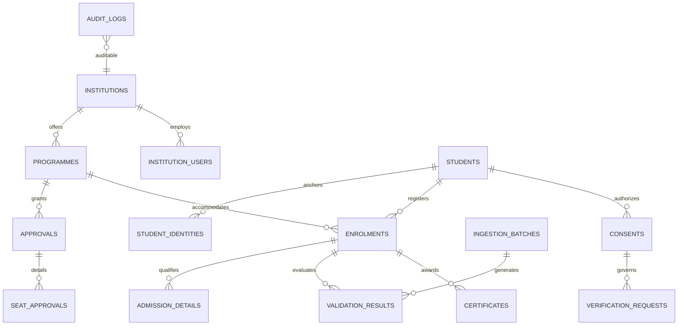

# Database Schema: Waymark APAAR Hub
**Target Engine:** PostgreSQL 16+  
**Design Principles:** Fully normalized (3NF), ACID-compliant, strong foreign key constraints, temporal audit logs, and hash-chained integrity verification.

---

## 1. Entity-Relationship Overview



---

## 2. Table Specifications & DDL Scripts

### 2.1 Core Institution & Academic Master Tables

#### `institutions`
Stores accredited institutions approved by AICTE.
```sql
CREATE TABLE institutions (
    institution_id UUID PRIMARY KEY DEFAULT gen_random_uuid(),
    pid VARCHAR(50) UNIQUE NOT NULL, -- AICTE Permanent ID (e.g. "1-10293847")
    name VARCHAR(255) NOT NULL,
    address TEXT NOT NULL,
    state VARCHAR(100) NOT NULL,
    district VARCHAR(100) NOT NULL,
    regional_office VARCHAR(100) NOT NULL, -- e.g. "WRO", "SRO", "NRO"
    institution_type VARCHAR(50) NOT NULL, -- 'GOVERNMENT', 'GOVT_AIDED', 'PRIVATE_SELF_FINANCED', etc.
    status VARCHAR(30) NOT NULL DEFAULT 'ACTIVE', -- 'ACTIVE', 'NO_ADMISSION', 'HIBERNATION', 'CLOSED'
    created_at TIMESTAMPTZ DEFAULT CURRENT_TIMESTAMP,
    updated_at TIMESTAMPTZ DEFAULT CURRENT_TIMESTAMP
);

CREATE INDEX idx_institutions_pid ON institutions(pid);
CREATE INDEX idx_institutions_state_district ON institutions(state, district);
```

#### `programmes`
Disciplines and degree levels offered by institutions.
```sql
CREATE TABLE programmes (
    programme_id UUID PRIMARY KEY DEFAULT gen_random_uuid(),
    institution_id UUID NOT NULL REFERENCES institutions(institution_id) ON DELETE RESTRICT,
    programme_name VARCHAR(150) NOT NULL, -- e.g. "Computer Engineering", "Mechanical Engineering"
    level VARCHAR(20) NOT NULL, -- 'DIPLOMA', 'UG', 'PG', 'PGDM', 'DOCTORAL'
    course_code VARCHAR(50),
    duration_years INT NOT NULL DEFAULT 4,
    is_active BOOLEAN DEFAULT TRUE,
    created_at TIMESTAMPTZ DEFAULT CURRENT_TIMESTAMP,
    CONSTRAINT uq_institution_programme UNIQUE (institution_id, programme_name, level)
);
```

#### `approvals` & `seat_approvals`
Tracks annual sanctioned intake from AICTE EoA orders.
```sql
CREATE TABLE approvals (
    approval_id UUID PRIMARY KEY DEFAULT gen_random_uuid(),
    programme_id UUID NOT NULL REFERENCES programmes(programme_id) ON DELETE RESTRICT,
    academic_year VARCHAR(10) NOT NULL, -- e.g. "2026-27"
    eoa_reference_number VARCHAR(100) NOT NULL,
    approved_intake INT NOT NULL CHECK (approved_intake >= 0),
    is_supernumerary_eligible BOOLEAN DEFAULT TRUE,
    approval_date DATE NOT NULL,
    created_at TIMESTAMPTZ DEFAULT CURRENT_TIMESTAMP,
    CONSTRAINT uq_programme_academic_year UNIQUE (programme_id, academic_year)
);

CREATE TABLE seat_approvals (
    seat_approval_id UUID PRIMARY KEY DEFAULT gen_random_uuid(),
    approval_id UUID NOT NULL REFERENCES approvals(approval_id) ON DELETE CASCADE,
    category_code VARCHAR(30) NOT NULL, -- 'NRI', 'FN_OCI_CIWG', 'TFW', 'PM_USPY', 'GIFTED_CHILDREN'
    approved_seats INT NOT NULL DEFAULT 0,
    is_above_intake BOOLEAN NOT NULL DEFAULT TRUE, -- TRUE for FN/TFW; FALSE for NRI
    remarks VARCHAR(255),
    CONSTRAINT uq_approval_category UNIQUE (approval_id, category_code)
);
```

---

### 2.2 Student Identity & Enrolment Tables

#### `students`
Master academic identity entity representing a human learner.
```sql
CREATE TABLE students (
    student_id UUID PRIMARY KEY DEFAULT gen_random_uuid(),
    full_name VARCHAR(200) NOT NULL,
    dob DATE NOT NULL,
    gender VARCHAR(20) NOT NULL, -- 'MALE', 'FEMALE', 'OTHER'
    email VARCHAR(150),
    phone_hash VARCHAR(64), -- SHA-256 hashed for privacy
    identity_status VARCHAR(30) NOT NULL DEFAULT 'PENDING_APAAR', -- 'VERIFIED', 'PENDING_APAAR', 'ALTERNATIVE_ID', 'DISPUTED'
    created_at TIMESTAMPTZ DEFAULT CURRENT_TIMESTAMP,
    updated_at TIMESTAMPTZ DEFAULT CURRENT_TIMESTAMP
);
```

#### `student_identities`
Anchors APAAR IDs and international credentials to students.
```sql
CREATE TABLE student_identities (
    identity_id UUID PRIMARY KEY DEFAULT gen_random_uuid(),
    student_id UUID NOT NULL REFERENCES students(student_id) ON DELETE CASCADE,
    identity_type VARCHAR(30) NOT NULL, -- 'APAAR', 'PASSPORT', 'OCI_CARD', 'NATIONAL_ID'
    identity_value_encrypted TEXT NOT NULL, -- AES-256-GCM encrypted identifier
    identity_masked VARCHAR(20) NOT NULL, -- e.g. "XXXXXXXX9012"
    identity_checksum_hash VARCHAR(64) NOT NULL, -- HMAC-SHA256 for deterministic lookup without plaintext exposure
    verification_source VARCHAR(50) DEFAULT 'MOCK_ADAPTER', -- 'DIGILOCKER', 'ABC', 'API_LIVE', 'MOCK'
    verified_at TIMESTAMPTZ,
    CONSTRAINT uq_identity_type_checksum UNIQUE (identity_type, identity_checksum_hash)
);

CREATE INDEX idx_student_identity_hash ON student_identities(identity_checksum_hash);
```

#### `enrolments`
Represents an admission instance of a student in a specific programme.
```sql
CREATE TABLE enrolments (
    enrolment_id UUID PRIMARY KEY DEFAULT gen_random_uuid(),
    student_id UUID NOT NULL REFERENCES students(student_id) ON DELETE RESTRICT,
    programme_id UUID NOT NULL REFERENCES programmes(programme_id) ON DELETE RESTRICT,
    academic_year VARCHAR(10) NOT NULL, -- e.g. "2026-27"
    admission_year INT NOT NULL,
    current_year_of_study INT NOT NULL DEFAULT 1,
    roll_number_institutional VARCHAR(50) NOT NULL,
    university_reg_number VARCHAR(100),
    aicte_enrolment_number VARCHAR(100), -- Mandatory for PGDM under APH Annexure 6 (Clause 6.9)
    enrolment_status VARCHAR(30) NOT NULL DEFAULT 'ACTIVE', -- 'DRAFT', 'ACTIVE', 'TRANSFERRED', 'WITHDRAWN', 'COMPLETED', 'CANCELLED'
    enrolment_date DATE NOT NULL,
    created_at TIMESTAMPTZ DEFAULT CURRENT_TIMESTAMP,
    updated_at TIMESTAMPTZ DEFAULT CURRENT_TIMESTAMP,
    CONSTRAINT uq_student_active_programme UNIQUE (student_id, programme_id, academic_year)
);

CREATE INDEX idx_enrolments_programme_year ON enrolments(programme_id, academic_year, enrolment_status);
```

#### `admission_details`
Captures seat categorization and regulatory qualifying attributes.
```sql
CREATE TABLE admission_details (
    admission_detail_id UUID PRIMARY KEY DEFAULT gen_random_uuid(),
    enrolment_id UUID NOT NULL REFERENCES enrolments(enrolment_id) ON DELETE CASCADE,
    seat_category VARCHAR(30) NOT NULL, -- 'REGULAR_MERIT', 'MANAGEMENT', 'NRI', 'FN', 'OCI', 'CIWG', 'TFW', 'PM_USPY', 'LATERAL_ENTRY'
    admission_channel VARCHAR(50) NOT NULL, -- 'CENTRAL_COUNSELLING', 'INSTITUTE_LEVEL', 'SUPERNUMERARY_DIRECT'
    allotment_order_ref VARCHAR(100),
    is_supernumerary BOOLEAN NOT NULL DEFAULT FALSE,
    annual_family_income NUMERIC(12, 2), -- Needed for TFW rule verification (<= ₹8 Lakh)
    lateral_entry_type VARCHAR(30), -- 'DIPLOMA_ENGG', 'BSC_ALLIED'
    remarks TEXT
);
```

---

### 2.3 Bulk Ingestion & Validation Engine Tables

#### `ingestion_batches`
Tracks bulk file uploads and ERP API submissions.
```sql
CREATE TABLE ingestion_batches (
    batch_id UUID PRIMARY KEY DEFAULT gen_random_uuid(),
    institution_id UUID NOT NULL REFERENCES institutions(institution_id) ON DELETE RESTRICT,
    programme_id UUID REFERENCES programmes(programme_id),
    academic_year VARCHAR(10) NOT NULL,
    uploaded_by_user UUID NOT NULL,
    file_name VARCHAR(255),
    file_storage_path TEXT,
    total_records INT NOT NULL DEFAULT 0,
    valid_records INT NOT NULL DEFAULT 0,
    flagged_records INT NOT NULL DEFAULT 0,
    batch_status VARCHAR(30) NOT NULL DEFAULT 'PROCESSING', -- 'PROCESSING', 'COMPLETED', 'FAILED', 'DRY_RUN'
    created_at TIMESTAMPTZ DEFAULT CURRENT_TIMESTAMP,
    completed_at TIMESTAMPTZ
);
```

#### `validation_results`
Stores automated rule evaluation results, flags, and warnings.
```sql
CREATE TABLE validation_results (
    result_id UUID PRIMARY KEY DEFAULT gen_random_uuid(),
    batch_id UUID REFERENCES ingestion_batches(batch_id) ON DELETE CASCADE,
    enrolment_id UUID REFERENCES enrolments(enrolment_id) ON DELETE SET NULL,
    rule_code VARCHAR(50) NOT NULL, -- 'RULE_INTAKE_CAP', 'RULE_CROSS_INSTITUTION_DUPLICATE', 'RULE_NRI_5_PCT', etc.
    severity VARCHAR(20) NOT NULL, -- 'INFO', 'WARNING', 'CRITICAL'
    violation_message TEXT NOT NULL,
    aph_clause_reference VARCHAR(100) NOT NULL,
    details_json JSONB, -- Context data: { "approved": 120, "enrolled": 126, "excess": 6 }
    resolution_status VARCHAR(30) DEFAULT 'OPEN', -- 'OPEN', 'OFFICER_REVIEWING', 'RESOLVED_VALID', 'RESOLVED_EXEMPT'
    created_at TIMESTAMPTZ DEFAULT CURRENT_TIMESTAMP
);

CREATE INDEX idx_validation_results_rule ON validation_results(rule_code, severity, resolution_status);
```

---

### 2.4 DPDP Consent, Verification & Audit Tables

#### `consents`
DPDP Act 2023 compliant data sharing consent records.
```sql
CREATE TABLE consents (
    consent_id UUID PRIMARY KEY DEFAULT gen_random_uuid(),
    student_id UUID NOT NULL REFERENCES students(student_id) ON DELETE CASCADE,
    verifier_id UUID NOT NULL,
    purpose VARCHAR(150) NOT NULL, -- e.g. "EMPLOYMENT_BACKGROUND_CHECK"
    scope_fields JSONB NOT NULL, -- ["full_name", "programme_name", "institution_name", "graduation_status"]
    status VARCHAR(30) NOT NULL DEFAULT 'PENDING', -- 'PENDING', 'GRANTED', 'DENIED', 'REVOKED', 'EXPIRED'
    granted_at TIMESTAMPTZ,
    expires_at TIMESTAMPTZ NOT NULL,
    revoked_at TIMESTAMPTZ,
    consent_signature_proof TEXT,
    created_at TIMESTAMPTZ DEFAULT CURRENT_TIMESTAMP
);
```

#### `verification_requests`
Audit records of all third-party credential checks.
```sql
CREATE TABLE verification_requests (
    request_id UUID PRIMARY KEY DEFAULT gen_random_uuid(),
    consent_id UUID REFERENCES consents(consent_id),
    verifier_id UUID NOT NULL,
    student_id UUID NOT NULL REFERENCES students(student_id),
    request_status VARCHAR(30) NOT NULL DEFAULT 'PENDING', -- 'PENDING', 'VERIFIED', 'REJECTED'
    result_payload_encrypted TEXT,
    cryptographic_signature TEXT,
    verified_at TIMESTAMPTZ,
    created_at TIMESTAMPTZ DEFAULT CURRENT_TIMESTAMP
);
```

#### `audit_logs` (Cryptographically Chained)
Guarantees tamper-evidence across the entire student management lifecycle.
```sql
CREATE TABLE audit_logs (
    log_id BIGSERIAL PRIMARY KEY,
    timestamp TIMESTAMPTZ DEFAULT CURRENT_TIMESTAMP,
    actor_id UUID NOT NULL,
    actor_role VARCHAR(50) NOT NULL,
    action VARCHAR(100) NOT NULL, -- 'UPLOAD_STUDENT_BATCH', 'FLAG_RESOLVED', 'VERIFICATION_ACCESSED'
    resource_type VARCHAR(50) NOT NULL, -- 'ENROLMENT', 'BATCH', 'APPROVAL'
    resource_id UUID NOT NULL,
    ip_address VARCHAR(45),
    details_json JSONB,
    previous_block_hash VARCHAR(64) NOT NULL,
    current_block_hash VARCHAR(64) NOT NULL
);

CREATE INDEX idx_audit_logs_resource ON audit_logs(resource_type, resource_id);
```

