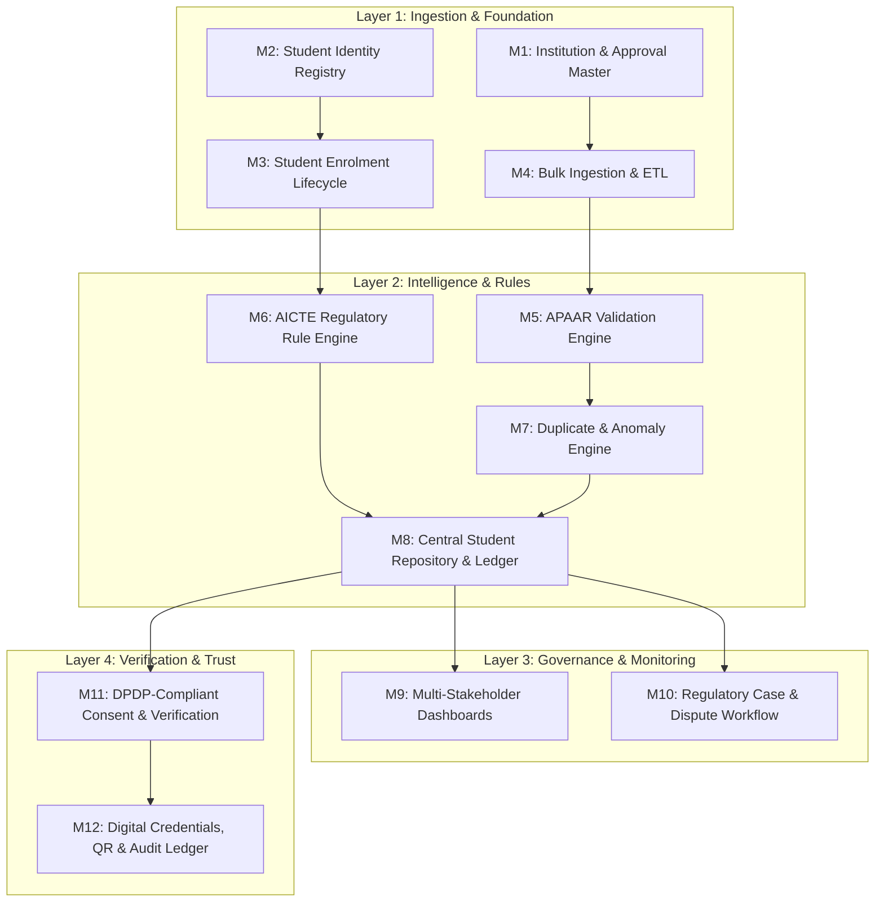

# Modules in the Project: Waymark APAAR Hub
**Problem Statement ID:** SIH 26263  
**Title:** APAAR ID-Based Student Data Management and Verification Platform for AICTE-Approved Institutions  
**Target Solution:** Waymark APAAR Hub (Team Phoenix Crew)

---

## 1. Architectural Overview & Module Taxonomy

The platform is architected as an enterprise modular system grouped into four distinct operational layers:
1. **Data Foundation & Institution Layer** (Modules 1 to 4)
2. **Validation, Anomaly & Compliance Engine Layer** (Modules 5 to 8)
3. **Dashboards, Governance & Analytics Layer** (Modules 9 & 10)
4. **Verification, Credentials & Trust Layer** (Modules 11 & 12)

---

## Module 1: Institution & Approval Master Management
### Purpose
Maintains the single source of truth for all AICTE-approved institutions, campus locations, programs, courses, and official Extension of Approval (EoA) allocations.

### Sub-features & Functional Capabilities
- **Institution Profile Registry:** AICTE Permanent ID (PID), institutional classification (Central/State Govt, Govt-aided, Self-Financed Private, Deemed-to-be University, Autonomous).
- **Authoritative EoA Intake Store:** Ingestion of approved annual intake per course directly from AICTE records; institutions **cannot** self-declare or edit their sanctioned capacity.
- **Supernumerary Quota Approval Flags:** Tracks explicit EoA permissions for supernumerary allocations:
  - Tuition Fee Waiver (TFW - up to 5%)
  - Foreign National (FN) / Overseas Citizen of India (OCI) / Children of Indian Workers in Gulf (CIWG - up to 15%)
  - PM-USPY (J&K / Ladakh) (max 2 per course, 10 per institute)
  - Gifted Children (max 2 per institute)
  - Kashmiri Migrants / Other regional quotas
- **Institution Status Lifecycle:** Active, No-Admission status (APH 7.3c), Under-Enrolment Hibernation (APH 6.12), or Closed/Withdrawn.
- **Campus Nodal Officer RBAC:** Mapping nodal officers, registrar credentials, and data operators with institutional email validation and two-factor authentication.

---

## Module 2: Student Identity Registry (APAAR & Fallback Engine)
### Purpose
Provides persistent digital identity anchoring using the 12-digit Automated Permanent Academic Account Registry (APAAR) ID, with robust support for transitional and non-APAAR students.

### Sub-features & Functional Capabilities
- **APAAR Syntax & Verhoeff Checksum Validation:** Pre-submission 12-digit format check and algorithmic validation.
- **Tri-State Identity Lifecycle:**
  - `VERIFIED`: Validated against authorized APAAR/UIDAI-linked repository.
  - `PENDING_APAAR`: Valid student who has applied for APAAR; flagged for provisional admission tracking without blocking their academic enrolment.
  - `ALTERNATIVE_ID`: Non-citizen / international students using Passport / OCI registration / national identity token.
  - `IDENTITY_MISMATCH`: Format valid, but demographic details conflict.
- **Identity Redaction & Masking:** Generates salted pseudo-hash identifiers for public logs and verifier sessions; never stores raw identity unencrypted.
- **Correction & Identity Reconciliation:** Controlled workflow for updating student identity details after institutional registrar sign-off.

---

## Module 3: Student Enrolment Lifecycle Management
### Purpose
Decouples persistent student identity from institutional enrolment instances, enabling accurate tracking of transfers, dual degrees, dropouts, and historical mobility.

### Sub-features & Functional Capabilities
- **Multi-Instance Enrolment Architecture:** Allows one `StudentIdentity` to have multiple chronological `Enrollment` instances (e.g., Diploma -> B.Tech Lateral Entry -> PGDM).
- **Quota & Category Categorization:**
  - Regular Merit / State Counselling
  - Management Quota
  - NRI Quota (APH 2.8b: strictly within approved intake, capped at 5%)
  - FN/OCI/CIWG Quotas (supernumerary, above approved intake)
  - TFW / PM-USPY / Lateral Entry
- **Enrolment State Machine:**
  `DRAFT` -> `SUBMITTED` -> `PROVISIONALLY_ENROLLED` -> `ACTIVE` -> `TRANSFERRED` / `WITHDRAWN` / `COMPLETED` / `CANCELLED`.
- **Lateral Entry Calculator:** Tracks admission into 2nd year (APH 6.13: 10% of approved intake plus actual vacant seats from 1st year).

---

## Module 4: Bulk Data Ingestion & Integration ETL
### Purpose
Provides high-throughput, error-tolerant ingestion of student records via Excel/CSV templates and modern REST APIs for existing College ERPs.

### Sub-features & Functional Capabilities
- **Dual-Channel Ingestion:** Standardized AICTE XLSX/CSV upload and secured RESTful Bulk Ingestion endpoints.
- **Dry-Run Validation Mode:** Institutions can run pre-submission dry-runs to inspect errors, warnings, and intake implications without committing records.
- **Async Chunked Processing:** Background processing of large datasets (up to 10,000+ records per batch) with instant HTTP receipt.
- **Granular Error Reporting:** Generates a downloadable error spreadsheet detailing row number, field name, violated rule code, and corrective instruction.
- **Partial Batch Acceptance & Re-submission:** Valid records can be staged while errored records are isolated for institutional re-upload.

---

## Module 5: APAAR Registry Integration Adapter
### Purpose
Abstracts external government identity systems with high availability, graceful degradation, and mock capabilities for testing and hackathons.

### Sub-features & Functional Capabilities
- **Pluggable Adapter Pattern:** 
  - `LiveGovAdapter`: Connects to official APAAR / DigiLocker / ABC gateway via mTLS and authorized API keys.
  - `SandboxMockAdapter`: Deterministic mock sandbox for demo, testing, and edge cases (invalid IDs, synthetic name mismatches).
- **Demographic Verification:** Compares institutional student name, DOB, and gender against the APAAR central token.
- **Circuit Breaker & Fallback Caching:** Prevents system deadlock when external identity registries experience high latency or downtime.

---

## Module 6: AICTE Regulatory Rule Engine (APH 2024-27)
### Purpose
A centralized, versioned, and explainable rule execution engine that calculates institutional admission compliance against AICTE Approval Process Handbook (APH) regulations.

### Sub-features & Functional Capabilities
- **Intake Pool Deconstruction:** Separate calculation of within-intake pools (Regular + NRI) vs supernumerary pools (TFW, FN/OCI/CIWG, PM-USPY, Gifted Children).
- **Rule Clause Verification:**
  - **Clause 2.8(b):** $\text{NRI Seats} \le 5\% \times \text{Approved Intake}$ (within intake).
  - **Clause 2.9:** $\text{FN/OCI/CIWG Seats} \le 15\% \times \text{Approved Intake}$ (supernumerary, 1/3 reserved for CIWG).
  - **Clause 6.42:** $\text{TFW Seats} \le 5\% \times \text{Approved Intake}$ (requires $\ge 50\%$ intake filled in prior year; income $\le ₹8$ Lakh).
  - **Clause 6.13:** $\text{Lateral Entry} \le 10\% \times \text{Approved Intake} + \text{Prior Year Vacancies}$.
  - **Clause 6.12:** Under-Enrolment Alert ($<30\%$ intake for 5 consecutive years).
  - **Annexure 6 (6.8/6.9):** PGDM data submission deadline tracking (30 days from cut-off) and mandatory AICTE Enrolment Number allocation.
- **Explainable Anomaly Output:** Every flag outputs:
  - Exact rule ID & Handbook clause
  - Calculated threshold vs actual submitted value
  - Excess count and specific student IDs involved
  - Recommended non-punitive officer review action

---

## Module 7: Duplicate & Anomaly Detection Engine
### Purpose
Identifies concurrent enrolments, duplicate identities within and across institutions, and suspicious admission anomalies.

### Sub-features & Functional Capabilities
- **Level 1 (Exact Collision):** Detects identical APAAR IDs across different institutions with active concurrent enrolment.
- **Level 2 (Intra-Batch Collision):** Detects duplicate entries in the same institutional upload batch.
- **Level 3 (Fuzzy Demographic Matching):** Employs TF-IDF and Jaro-Winkler string distance on Name + DOB + Father's Name to detect students enrolled under different or pending IDs.
- **Pattern Anomaly Analytics:** Flags statistical oddities (e.g., 100% NRI quota utilization in 24 hours, sudden spikes in supernumerary categories, repeated identity validation failures).
- **Dual Notification Dispatch:** When cross-institution duplication is detected, both institutions receive synchronized notification without revealing private student data.

---

## Module 8: Central Student Repository & State Ledger
### Purpose
The authoritative PostgreSQL relational repository maintaining the immutable lifecycle, audit references, and state transitions of student academic journeys.

### Sub-features & Functional Capabilities
- **Relational Integrity & ACID Compliance:** Enforces strict foreign keys, atomic batch transactions, and composite unique constraints.
- **Temporal Versioning:** Stores historical snapshots of enrolment records upon approved amendments.
- **Partitioned Scalability:** Database partitioning by academic year and state for high-speed indexing across millions of student records.

---

## Module 9: Multi-Stakeholder Dashboards & Analytics
### Purpose
Tailored web interfaces providing role-specific operational, compliance, and analytical insights with clean, light-mode design.

### Sub-features & Functional Capabilities
- **AICTE Central / Regional Officer Dashboard:**
  - National heatmap of intake utilization and excess admission alerts.
  - Institutional Compliance Risk Score (ranking institutes by unaddressed flags, late uploads, and excess intake).
  - Regional drill-downs (State -> District -> Institute -> Course).
- **Institution Nodal Dashboard:**
  - Real-time seat allocation gauges (Filled vs Approved for Regular, NRI, TFW, FN).
  - Upload batch history, dry-run auditor, and one-click reconciliation tools.
  - Flag resolution panel for addressing AICTE queries.
- **Student Academic Identity Portal:**
  - Personal enrolment ledger, linked degree/diploma courses, and APAAR verification status.
  - Active consent manager for viewing and granting/revoking verifier access.
- **Employer / Public Verifier Portal:**
  - Request verification by APAAR ID + Verification Code.
  - Track consent approval status and view cryptographic verification certificates.

---

## Module 10: Regulatory Case & Dispute Workflow
### Purpose
Implements the core design principle: **"A flag never penalizes automatically; an authorized officer decides."**

### Sub-features & Functional Capabilities
- **Automated Case Generation:** High-severity flags (e.g., admissions $> \text{Intake} + \text{Supernumerary}$) generate structured regulatory review cases.
- **Show-Cause & Institutional Clarification Pipeline:** AICTE officers issue digital clarification requests; institutions submit documentary evidence (e.g., counselling allotment letters, court orders).
- **Officer Decision Recording:** AICTE officer records outcome (`Approved Exemption`, `Rectification Required`, `Intake Adjusted`, `Escalated for Penalty`).
- **Indicative Penalty Calculator:** Computes indicative financial penalties under APH Chapter VII (e.g., 5x tuition fee for excess admissions) for officer reference only.

---

## Module 11: DPDP-Compliant Consent & Verification Engine
### Purpose
Ensures complete alignment with the Digital Personal Data Protection (DPDP) Act 2023 and DPDP Rules 2025 for student data disclosures.

### Sub-features & Functional Capabilities
- **Purpose-Bound Granular Consent:** Verifiers must specify purpose (e.g., `Employment Background Check`, `Higher Studies Admission`, `Government Scheme Subsidy`).
- **Field-Level Access Control:** The student selects which specific attributes are disclosed (e.g., Disclose `Course & Completion Status`, Hide `Date of Birth & Category`).
- **Time-Bound Consent Tokens:** Verification tokens expire after a configurable duration (e.g., 48 hours or single-use).
- **Revocation Engine:** Students can withdraw consent at any time prior to verifier access.
- **Signed Cryptographic Verification Result:** Verifier receives a JSON/PDF payload digitally signed with AICTE's ECDSA/RSA key pair, proving authenticity without direct database access.

---

## Module 12: Digital Credentials, QR & Tamper-Evident Audit Ledger
### Purpose
Provides verifiable paperless credential issuance and tamper-proof operational auditing.

### Sub-features & Functional Capabilities
- **Certificate Integration Spec:** Mandates printing APAAR ID alongside Institutional Student ID on all degrees, diplomas, and mark sheets.
- **Dynamic Verification QR Code:** Generates secure QR codes linking to an authenticated verification endpoint.
- **SHA-256 Chained Audit Ledger:** Every state change, student upload, officer decision, and verification view appends a block containing:
  $$\text{Hash}_n = \text{SHA256}(\text{Payload}_n \parallel \text{Hash}_{n-1} \parallel \text{Timestamp} \parallel \text{ActorID})$$
- **Audit Verification Command:** Built-in auditor endpoint that recalculates the hash chain and flags any external database tampering or out-of-sequence row modifications.

