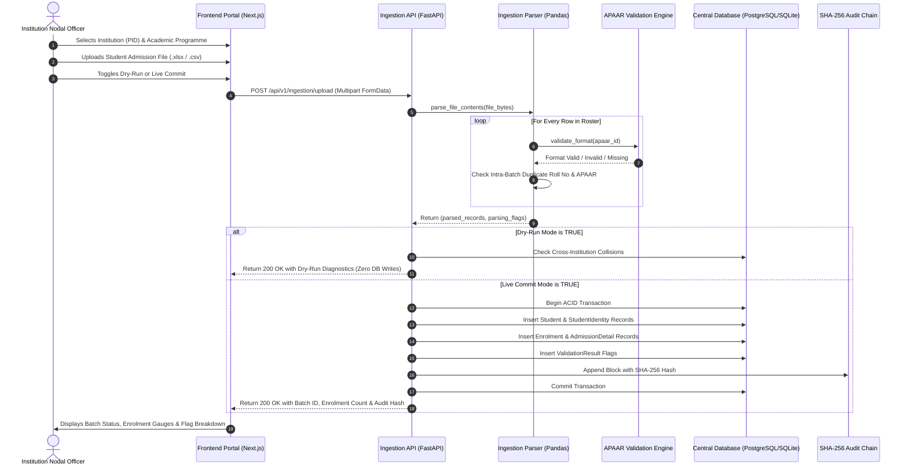

# Slice 1: Student Admission Ingestion & Identity Pipeline
**Status:** Completed & Verified  
**Covers Modules:** Module 1 (Institution Master), Module 2 (Student Identity Registry), Module 3 (Student Enrolment Lifecycle), Module 4 (Bulk Ingestion & ETL), and Module 5 (APAAR Validation Engine).

---

## 1. Executive Summary

Slice 1 establishes the core foundational pipeline through which AICTE-approved institutions submit student-level admission data using APAAR ID as the primary academic identifier. It provides dual-mode ingestion (Dry-Run vs. Live Commit), dynamic template generation, algorithmic 12-digit format and Verhoeff validation, cross-institution collision detection, and cryptographic SHA-256 audit block logging.

---

## 2. Features Created in Slice 1

### 2.1 Standardized AICTE Template Generation
- **Dynamic Endpoint:** `GET /api/v1/ingestion/template?format=csv` (or `.xlsx`).
- Generates official spreadsheets pre-loaded with sample data covering regular merit, tuition fee waiver (TFW), and provisional non-APAAR students.
- Enforces standardized column schemas:
  - `apaar_id`, `full_name`, `dob`, `gender`, `roll_number_institutional`, `seat_category`, `admission_channel`, `allotment_order_ref`, `annual_family_income`.

### 2.2 Robust Ingestion Parser & Pre-Flight Validator
- **Parser Engine (`IngestionParser`):** Handles both `.csv` and `.xlsx` files seamlessly.
- **Syntactic & Algorithmic Validation:**
  - 12-digit numeric constraint with Verhoeff check-digit permutation validation.
  - Identification of intra-batch duplicates (repeated APAAR IDs or institutional roll numbers within the same file).
- **Provisional Admission Pathway (`PENDING_APAAR`):**
  - If a student has not yet obtained an APAAR ID, the platform registers them in a `PENDING_APAAR` provisional state with an advisory warning rather than rejecting the student.

### 2.3 Atomic Ingestion Service & Cross-Institution Detection
- **Execution Engine (`AdmissionIngestionService`):**
  - Evaluates cross-institution collisions: flags students currently marked as `ACTIVE` in another institution's roster.
  - **Dry-Run Mode:** Evaluates all rules, counts, and errors and returns a structured diagnostics report without writing any rows to the database.
  - **Live Commit Mode:** Executes within an atomic database transaction. Creates `Student`, `StudentIdentity`, `Enrolment`, and `AdmissionDetail` records.

### 2.4 Cryptographic SHA-256 Chained Audit Logging
- Every batch admission commit generates an immutable audit record:
  $$\text{Block Hash}_n = \text{SHA256}(\text{Payload} \parallel \text{Previous Hash} \parallel \text{Actor} \parallel \text{Timestamp})$$
- Guarantees complete audit traceability and tamper-evidence.

### 2.5 Light-Aesthetic UI Upload Dashboard
- Built in Next.js 14 App Router (`frontend/src/app/page.tsx`):
  - Target institution and approved programme selector.
  - Drag-and-drop file upload zone.
  - One-click template download (.csv / .xlsx).
  - Dry-Run pre-flight toggle.
  - Real-time flag drawer displaying row numbers, violated rule codes, and actionable advice.

---

## 3. End-to-End Workflow of Slice 1

---

## 4. Test Verification & Results

Automated Pytest suite executed via [backend/tests/test_slice1_ingestion.py](file:///d:/SIH-AICTE-APAAR/backend/tests/test_slice1_ingestion.py):

| Test Case | Scenario Evaluated | Result |
|---|---|---|
| `test_apaar_syntax_and_verhoeff` | Tests 12-digit format, short length, non-numeric strings, and Verhoeff permutations. | **PASSED** |
| `test_ingestion_parser_with_sample_template` | Verifies CSV parsing, mandatory field checks, and provisional `PENDING_APAAR` warning generation. | **PASSED** |
| `test_dry_run_vs_live_commit` | Verifies that dry-run mode commits 0 records to the database, while live mode commits 100% of valid records and updates the SHA-256 audit chain. | **PASSED** |
| **Frontend Production Build** | Compiles TypeScript types, Tailwind CSS, and Next.js 14 App Router without linting or type errors. | **PASSED** |

