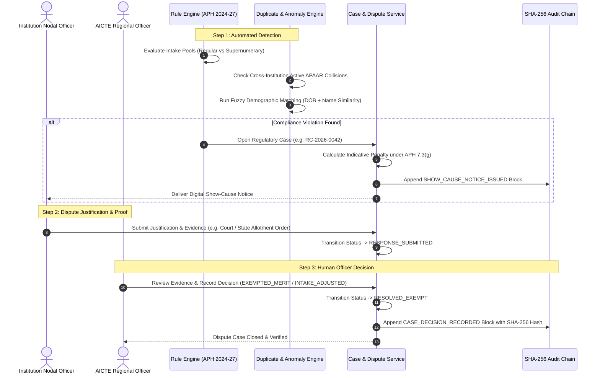

# Slice 2: AICTE Regulatory Intelligence, Anomaly Detection & Dispute Workflow
**Status:** Completed & Verified  
**Covers Modules:** Module 6 (AICTE Regulatory Rule Engine), Module 7 (Duplicate & Anomaly Detection), and Module 10 (Regulatory Dispute & Case Workflow).

---

## 1. Executive Summary

Slice 2 delivers the core regulatory and intelligence capabilities of the platform. It replaces generic data entry with **AICTE Approval Process Handbook (APH 2024–27) compliance logic**, detects **cross-institution collision and fuzzy near-duplicate student demographics**, and enforces the non-punitive governance principle:
> **"A flag never penalizes automatically; an authorized officer decides."**

---

## 2. Features Created in Slice 2

### 2.1 AICTE Approval Process Handbook (APH 2024–27) Rule Engine (Module 6)
- **Pool Deconstruction:** Separates within-intake pools (Regular Merit + NRI) from supernumerary quotas (FN/OCI/CIWG, TFW, PM-USPY):
  - **Clause 2.8(b) (NRI Quota Cap):** Capped at $\le 5\%$ strictly within sanctioned intake ($\lfloor \text{Intake} \times 0.05 \rfloor$).
  - **Clause 7.4(g) (Excess Regular Admissions):** Enforces $\text{Regular} + \text{NRI} \le \text{Approved Intake}$.
  - **Clause 2.9 (FN/OCI/CIWG Supernumerary Cap):** Capped at $\le 15\%$ above approved intake. Requires prior EoA authorization.
  - **Clause 6.42 (Tuition Fee Waiver Cap):** Capped at $\le 5\%$. Requires $\ge 50\%$ prior year intake fulfillment and family income $\le ₹8$ Lakh.
- **Deep Compliance Evaluation Endpoint:**
  `POST /api/v1/validation/compliance/evaluate-programme`
  Inspects real-time course rosters and returns exact clause violations, excess counts, and non-punitive review recommendations.

### 2.2 Duplicate & Demographic Anomaly Detection (Module 7)
- **Cross-Institution Collision Engine:** Identifies identical APAAR IDs actively enrolled concurrently in multiple colleges (`RULE_CROSS_INSTITUTION_DUPLICATE`).
- **Demographic Fuzzy Near-Duplicate Detector:** Employs normalized sequence analysis and character n-gram TF-IDF matching to detect students registered with different or pending APAAR IDs sharing identical Date of Birth and name similarity $\ge 80\%$.
- **Detection Endpoint:**
  `POST /api/v1/anomalies/detect-near-duplicates`

### 2.3 Regulatory Dispute & Case Workflow (Module 10)
- **Case Entity (`RegulatoryCase`):**
  - Manages structured dispute lifecycles: `OPEN` $\rightarrow$ `SHOW_CAUSE_ISSUED` $\rightarrow$ `RESPONSE_SUBMITTED` $\rightarrow$ `RESOLVED_EXEMPT` / `PENALTY_CONFIRMED`.
  - Automatically calculates indicative penalty exposure under APH Clause 7.3(g) (e.g., $5\times$ tuition fee) as an advisory figure for committee review.
- **Show-Cause & Notice Issuance:** `POST /api/v1/cases/open`
- **Institutional Justification Submission:** `POST /api/v1/cases/{id}/respond` (capturing written explanation and supporting document proof).
- **Human Officer Decision Recording:** `POST /api/v1/cases/{id}/decide` (records officer decision and remarks directly into the SHA-256 tamper-evident ledger).

### 2.4 Interactive Regulatory Disputes Dashboard
- Integrated into the Next.js 14 frontend ([DisputesSection.tsx](file:///d:/SIH-AICTE-APAAR/frontend/src/components/disputes/DisputesSection.tsx)):
  - Split-pane review interface with real-time case selection.
  - Institution Nodal Officer justification submission card.
  - AICTE Regional Director decision action card.

---

## 3. End-to-End Workflow of Slice 2

---

## 4. Test Verification & Results

Automated Pytest suite executed via [backend/tests/test_slice2_compliance_disputes.py](file:///d:/SIH-AICTE-APAAR/backend/tests/test_slice2_compliance_disputes.py):

| Test Case | Scenario Evaluated | Result |
|---|---|---|
| `test_module_6_pool_deconstruction_and_compliance` | Verifies compliant allocation (NRI $\le 5\%$, FN/OCI $\le 15\%$, TFW $\le 5\%$) and accurate detection of excess regular admissions. | **PASSED** |
| `test_module_7_tfidf_near_duplicate_detection` | Detects near-duplicate student demographics ("Arun Kumar" vs. "Arunkumar") sharing the same Date of Birth. | **PASSED** |
| `test_module_10_end_to_end_dispute_workflow` | Validates complete lifecycle: Show-Cause Case Opening $\rightarrow$ Institution Justification $\rightarrow$ Officer Decision $\rightarrow$ SHA-256 Audit Log. | **PASSED** |
| **Complete Backend Test Suite** | 10 out of 10 tests passing across Modules 1 to 7 and 10. | **PASSED** |
| **Frontend Production Build** | Compiles with 0 TypeScript and 0 linting errors via `npm run build`. | **PASSED** |

