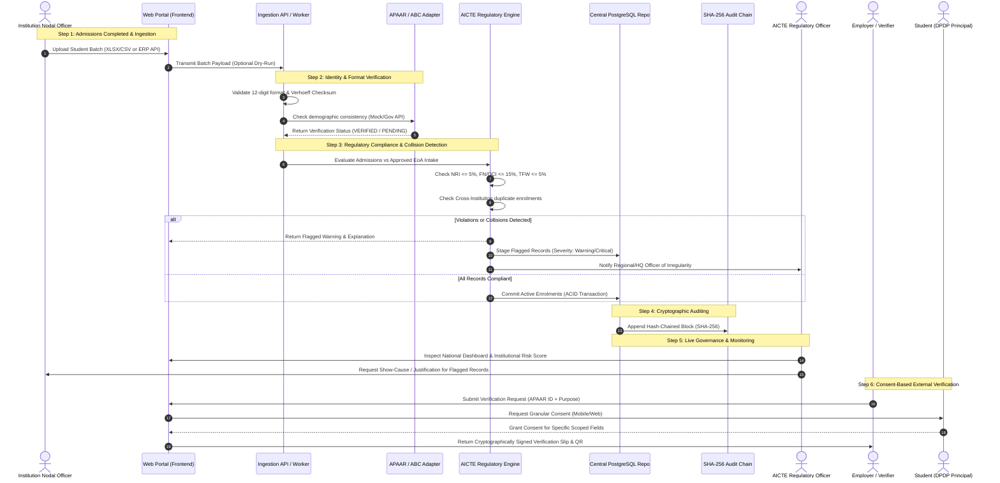
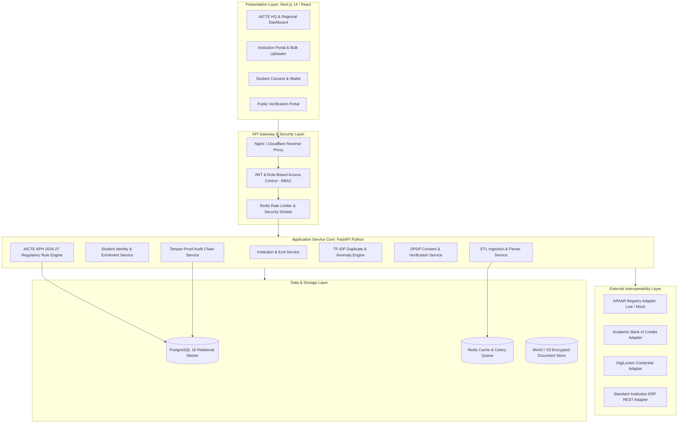

# System Workflow and Architecture: Waymark APAAR Hub
**Problem Statement:** SIH 26263  
**System Class:** Distributed Multi-Tenant Regulatory Intelligence Platform  

---

## 1. End-to-End System Workflow

---

## 2. High-Level System Architecture

The architecture adopts a **Modular Clean Monolith** pattern designed for rapid hackathon execution and linear horizontal scaling:

---

## 3. Component Details & Design Decisions

### 3.1 Modular Monolith vs Microservices
- **Decision:** Modular Monolith (FastAPI + SQLAlchemy 2.0).
- **Justification:** For SIH and regulatory compliance systems, strong transactional guarantees (ACID) across student records, institutional approvals, and audit logs are paramount. A distributed microservices setup adds network latency, eventual consistency headaches, and distributed transaction complexities without tangible benefits at this stage.

### 3.2 Dual-Tier Validation Architecture
1. **Tier 1 (Fast-Path Synchronous):**
   - Format checks, checksums, null checks, and local file duplicate checks execute synchronously during file parsing ($< 500\text{ ms}$).
2. **Tier 2 (Deep Asynchronous Regulatory Evaluation):**
   - Cross-database duplicate detection, AICTE handbook rule checks, and fuzzy demographic matching run in background worker tasks managed by Celery/Redis.

### 3.3 Cryptographic Trust Framework
- **Tamper-Evident Audit Chain:** Every institutional update, officer exemption, and verification access is hashed into an immutable linear chain:
  $$\text{Block Hash}_i = \text{SHA256}(\text{Record ID} + \text{Payload} + \text{Timestamp} + \text{Actor} + \text{Block Hash}_{i-1})$$
- **Digital Credential Signature:** Verification outputs are signed using ECDSA (Curve P-256) with AICTE's private key, verifiable via public key embedded in the QR code.

